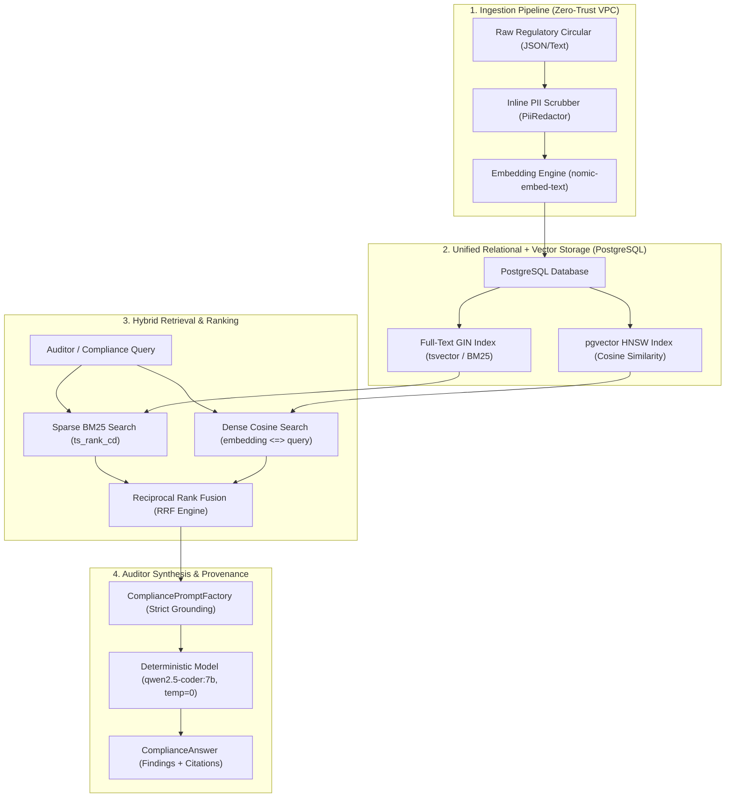
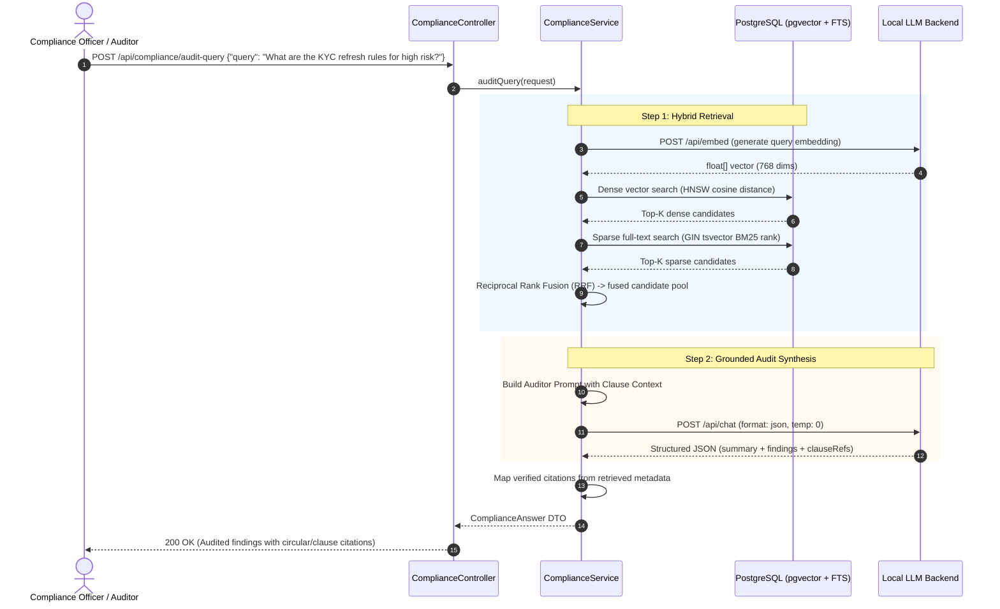

# Portfolio Blueprint 1: Compliance & Regulatory Document Engine

**Target Role:** AI Solution Architect | Principal AI Engineer (BFSI / Regulated Fintech)  
**Deliverables:** Production Implementation, Mermaid Architecture & Sequence Diagrams, 3 ADRs.

---

## 1. Executive Summary

In regulated financial services (banking, insurance, asset management), compliance teams, internal risk auditors, and credit officers spend thousands of hours manually reviewing regulatory circulars (e.g. RBI Master Directions, OCC bulletins, Basel III frameworks, EU AI Act requirements).

Standard consumer RAG ("chat over PDF") fails drastically in enterprise banking because:
1. **PII Egress:** Ingesting files with account numbers, names, or PANs violates data protection regulations.
2. **Missing Specific Legal References:** Dense vectors frequently fail on exact circular numbers (`RBI/2024-25/112`) or clause identifiers (`Section 4.2(a)`).
3. **Audit Hallucination:** Generating compliance guidance without verifiable clause-level attribution violates Model Risk Management (SR 11-7) mandates.

**Blueprint 1** solves this with an enterprise-grade architecture:
* **Inline PII Redaction:** Regex-based sanitization of PAN, Aadhaar, GSTIN, card numbers, and emails before embedding generation.
* **Hybrid Search with Reciprocal Rank Fusion (RRF):** PostgreSQL Full-Text Search (sparse/BM25) combined with `pgvector` cosine similarity (dense).
* **Auditor Attribution:** JSON-constrained outputs linking every finding directly to source circulars and clauses.

---

## 2. Architecture Diagram



---

## 3. End-to-End Sequence Diagram



---

## 4. Key Architectural Patterns

### Pattern 1: Reciprocal Rank Fusion (RRF)
RRF combines the ranked outputs of dense vector search and sparse full-text search without requiring score normalization:
$$RRF(d) = \sum_{m \in \{\text{dense}, \text{sparse}\}} \frac{1}{60 + \text{rank}_m(d)}$$
* An exact circular match ranks #1 in sparse search.
* A conceptual paraphrase ranks #1 in dense search.
* A document matching both gets dual rank contributions, guaranteeing it reaches the top of the prompt context.

### Pattern 2: Relational PostgreSQL Single-Engine Advantage
Unlike systems deploying separate Pinecone or Milvus clusters, our solution runs both vector search and BM25 full-text indexing directly inside PostgreSQL:
* **Atomic writes:** No dual-write failure window between relational metadata and embeddings.
* **Unified RBAC:** Existing database access controls, row-level security (RLS), and VPC firewalls apply directly to vectors.
* **Zero Egress:** High-risk banking circulars never leave the enterprise boundary.

### Pattern 3: Clause-Level Audit Attributions
Every compliance conclusion returns a structured tuple:
```json
{
  "finding": "High-risk customer KYC records require mandatory updation at least once every 2 years.",
  "circularId": "RBI/2024-25/112",
  "clauseRef": "Section 4.2(a)",
  "confidence": 0.99
}
```
If the retrieved corpus lacks grounding, the system strictly outputs `"INSUFFICIENT_REGULATORY_GROUNDING"` rather than hallucinating regulatory policy.

---

## 5. Architectural Decision Records (ADRs)

1. [ADR-001: pgvector vs. Dedicated Vector Databases](adr/ADR-001-pgvector-vs-dedicated-vector-db.md)
2. [ADR-002: Hybrid Retrieval with RRF vs. Dense-Only Search](adr/ADR-002-hybrid-search-rrf-vs-dense-only.md)
3. [ADR-003: Clause-Level Citation Attribution & Deterministic Refusal](adr/ADR-003-clause-level-citation-auditor-traceability.md)
